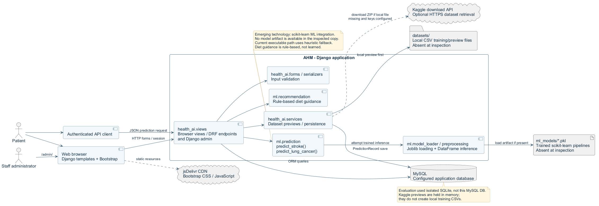
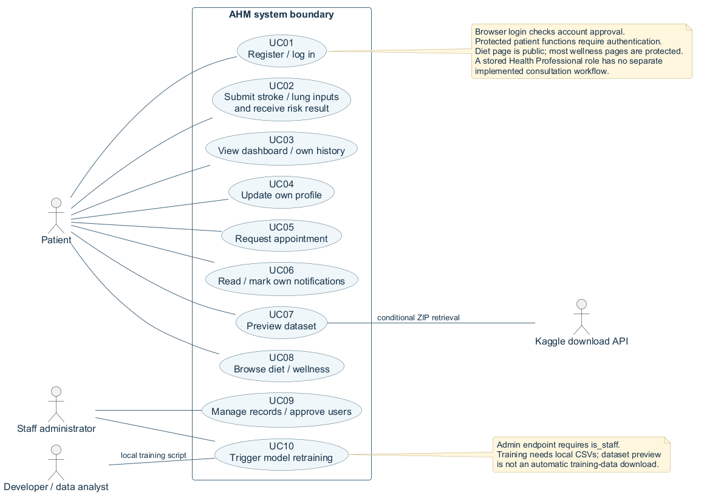
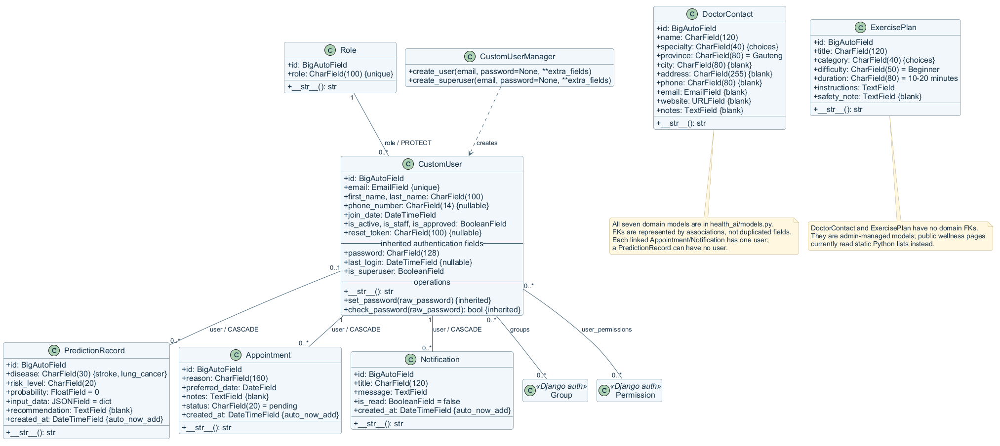
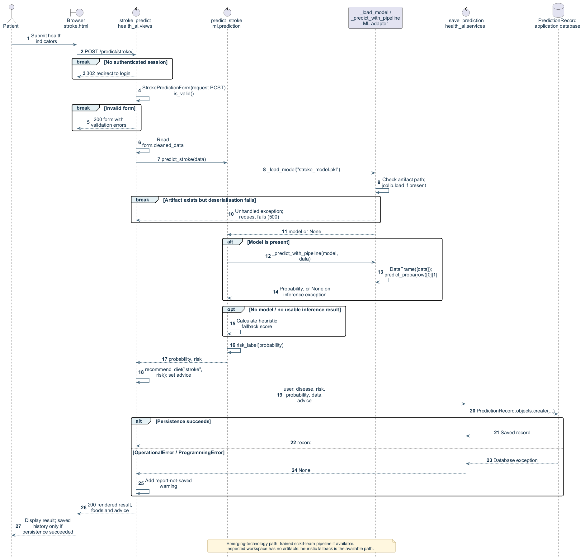

# ISJ107V Assignment 3 - Question 3.1-3.4

**Author:** Itebogeng Eugene Sebapu  
**Project:** Accurate Health Matrix (AHM) - AI-Powered Health Risk Prediction and Wellness Recommendation Web System  
**Prepared:** 30 September 2026

These diagrams describe the inspected implementation. They do not claim lecturer approval or verified clinical effectiveness. The workspace has ML training/inference code but no trained artifacts or training CSVs; fallback scoring is the available execution path.

## 3.1 High-level system architecture [2]

The browser and API client call the Django application. Browser views and DRF endpoints share form validation, prediction and persistence helpers. `health_ai.services` previews local CSVs first and conditionally retrieves ZIP archives through the Kaggle download API. The browser also loads Bootstrap from jsDelivr. MySQL is configured for normal operation; earlier tests used isolated SQLite.

**Design decisions:** ML code is separated from HTTP handlers so browser and API routes use the same prediction functions. Joblib/scikit-learn pipelines are used only if artifacts are available; missing or incompatible inference falls back to hand-coded scores. Diet recommendations remain rule-based. Dataset preview is not automatic training: remote CSV contents remain in memory. No separate cloud AI service or live clinical API is implemented.

**Code evidence:** `health_ai/urls.py`; `health_ai/views.py::stroke_predict, stroke_prediction_api, dataset_detail`; `health_ai/services.py::read_dataset_preview, read_dataset_from_kaggle, _save_prediction`; `ml/model_loader.py::_load_model`; `ml/preprocessing.py::_predict_with_pipeline`; `ml/prediction.py`; `ml/recommendation.py`; `config/settings.py`; `templates/base/base.html`.

## 3.2 Use-case diagram and detailed core use case [3]

Patient functions cover registration/login, predictions, personal history/profile, appointment requests, notifications, dataset previews and wellness information. Staff use Django admin and the retraining endpoint. Developers can invoke the local training script. Kaggle is a supporting external system only for conditional dataset downloads. A Health Professional role exists, but there is no separate implemented clinical-review use case. Browser login checks approval; this diagram does not certify consistent enforcement across all API authentication methods.

| Field | UC02 - Submit stroke indicators and receive a risk result |
| --- | --- |
| Primary actor | Patient with an authenticated session. |
| Trigger | Patient submits the form at `/predict/stroke/`. |
| Preconditions | Application is running; authenticated session exists. Database tables must be available to save history. A model file is optional because fallback is implemented. |
| Normal flow | 1. Patient opens the stroke form. 2. Patient enters health indicators and submits. 3. `StrokePredictionForm` validates and supplies cleaned data. 4. `predict_stroke` attempts to load a model and infer a probability from a named-column DataFrame. 5. `risk_label` returns Low, Medium or High Risk. 6. The view obtains diet suggestions and sets advice. 7. `_save_prediction` creates a `PredictionRecord`. 8. The browser displays risk, percentage, foods and advice; the saved report is available on the patient's dashboard. |
| A1 - No usable model | If the artifact is absent or the inference adapter returns None, the predictor computes the implemented heuristic score, then resumes at normal step 5. This is the available path in the inspected workspace. |
| A2 - Invalid input | The form displays validation errors. No prediction or report is produced. The patient corrects and resubmits. |
| A3 - No session | The login decorator redirects the browser to login before form processing. |
| A4 - Persistence unavailable | On OperationalError or ProgrammingError, the save helper returns None. The view displays the result with a warning that the report was not saved. |
| Exception | A corrupt Joblib artifact can raise an uncaught deserialisation exception and produce a server error; this is distinct from the caught inference failure. Other uncaught failures may also abort the request. |
| Postconditions | Successful calculation produces a displayed result. A history record exists only if persistence succeeded. No appointment or notification is automatically created by prediction. |

**Design decisions:** patient-owned queries support personal history; appointment requests are a separate workflow. Optional artifacts allow demonstration without a trained model, but heuristic output is not a calibrated medical probability. The lung workflow uses `LungCancerPredictionForm` and `predict_lung_cancer` in the same pattern.

**Code evidence:** `health_ai/views.py::stroke_predict, dashboard, appointments_view, notifications_view, retrain_models_api`; `health_ai/forms.py::StrokePredictionForm`; `health_ai/services.py::_save_prediction`; `ml/prediction.py::predict_stroke, risk_label`; `scripts/train_models.py`.

## 3.3 Class diagram [3]

All seven domain models are defined in `health_ai/models.py`. `CustomUserManager` supplies account-creation operations. Password/check-password operations and authentication fields are inherited from Django. Foreign keys are shown as associations rather than duplicated attribute rows. Automatic IDs are included. Group and Permission are Django authentication classes, not additional AHM domain models.

| Association | Implemented multiplicity and deletion behaviour |
| --- | --- |
| Role - CustomUser | A user has exactly one Role; a Role can have zero or many users. PROTECT prevents deleting a referenced role. |
| CustomUser - PredictionRecord | A user has zero or many reports; a report has zero or one user because the FK is nullable. Linked reports cascade when that user is deleted. |
| CustomUser - Appointment | A user has zero or many appointments; each appointment has exactly one user. CASCADE. |
| CustomUser - Notification | A user has zero or many notifications; each notification has exactly one user. CASCADE. |
| CustomUser - Group / Permission | Many-to-many membership and direct permissions. |
| DoctorContact / ExercisePlan | No domain foreign keys. They are registered in admin, but public pages currently read static Python lists instead of these tables. |

**Design decisions:** the custom user stores email identity and role/approval flags. PredictionRecord stores flexible input JSON alongside score, risk and advice. Domain classes primarily hold data; form validation and workflow operations belong to forms/views/services, so invented model methods are not shown. Historical database labels remain `accounts`, `predictions` and `wellness` despite canonical model definitions living together.

**Code evidence:** `health_ai/models.py::Role, CustomUser, CustomUserManager, PredictionRecord, Appointment, Notification, DoctorContact, ExercisePlan`; `health_ai/admin.py`; `health_ai/views.py::doctors, exercises`; `health_ai/wellness_data.py`.

## 3.4 Sequence diagram for a core transaction [3]

The transaction begins at the browser and reaches the `stroke_predict` controller. The form validates the request, the predictor invokes the optional model-loading/inference path, and the view delegates persistence to `_save_prediction`. The data participant is `PredictionRecord` in the application database. The ML adapter and optional Joblib artifact explicitly identify the emerging-technology interaction.

**Design decisions and failure paths:** unauthenticated and invalid requests stop early. A compatible pipeline receives `DataFrame([data])` so named training columns are preserved. Missing artifacts or inference exceptions produce fallback scoring; deserialisation errors remain uncaught and stop the request. The controller obtains diet advice, then attempts the database save. Caught database errors allow result display but no saved-history claim. These distinctions follow the code and avoid showing a successful clinical prediction or persistence when neither is established.

**Code evidence:** `health_ai/views.py::stroke_predict`; `health_ai/forms.py::StrokePredictionForm`; `ml/prediction.py::predict_stroke, risk_label`; `ml/model_loader.py::_load_model`; `ml/preprocessing.py::_predict_with_pipeline`; `ml/recommendation.py::recommend_diet`; `health_ai/services.py::_save_prediction`; `health_ai/models.py::PredictionRecord`.
